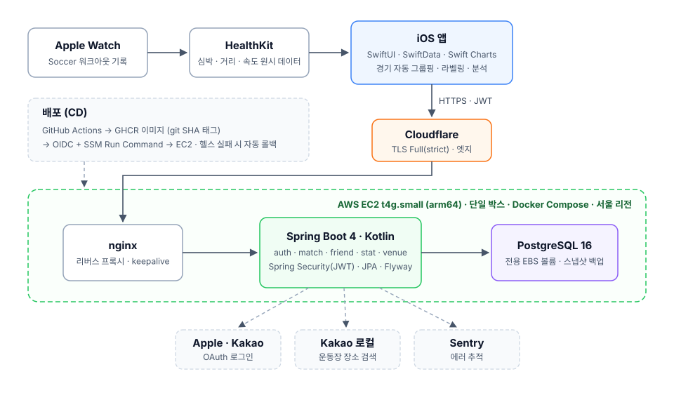

# KickLog

> 애플워치로 기록한 조기축구 경기를 쿼터 단위로 분석해 주는 iOS 앱과 Spring 백엔드

조기축구는 25분 × 4쿼터로 진행되고, 선수는 모든 쿼터를 뛰지 않습니다. KickLog 는 출전한 쿼터마다
워치에 기록된 Soccer 워크아웃을 **한 경기로 자동으로 묶고**, 이동거리·최고 속도·스프린트·심박을
쿼터별로 보여줍니다. 친구를 맺으면 서로의 경기 기록을 볼 수 있습니다.

- 1인 풀스택 개발 (iOS + 백엔드 + 인프라)
- 운영 중: `kicklog.org` (AWS 서울 리전)

---

## 주요 기능

| 기능 | 설명 |
|---|---|
| **경기 자동 그룹핑** | HealthKit 워크아웃을 시간 간격 90분, 거리 100m(Haversine) 기준으로 한 경기로 묶음 — [ADR-0002](docs/adr/0002-auto-grouping-thresholds.md) |
| **라벨링** | 출전 쿼터 체크, 상대팀·결과·포지션·골·어시스트·운동장 입력, 워크아웃 시작·종료 trim |
| **경기 리포트** | 이동거리 · 평균/최고 심박 · 최고 속도 · 스프린트 횟수 · 쿼터별 체력 변화 |
| **시즌 통계** | 연간·월별 누적 기록, 승률, 시즌 베스트 |
| **친구** | 1:1 양방향 친구, 친구의 경기·시즌 기록 열람 (심박 비공개 옵션) |
| **운동장** | 카카오 장소 검색 기반 운동장 등록·선택 |
| **로그인** | Sign in with Apple / 카카오 → 자체 JWT |

## 아키텍처

<p align="center">
  
</p>

- **iOS 가 매 경기 데이터의 1차 원본**입니다. HealthKit 원시 데이터는 기기에 두고, 분석 결과만 서버로 보냅니다.
- **백엔드**는 백업, 친구 공유, 시즌·월별 집계를 맡습니다 — [ADR-0003](docs/adr/0003-data-model-and-api.md)
- **3-tier 구조 + DDD-lite**: Controller / Service / Repository, Rich Aggregate + `@Embeddable` VO,
  `Request → Command → Result → Response` DTO 흐름 — [domain-modeling.md](docs/architecture/domain-modeling.md)

## 기술 스택

| 영역 | 스택 |
|---|---|
| iOS | Swift · SwiftUI · SwiftData · Swift Charts · HealthKit · CoreLocation (iOS 18+) |
| Backend | Kotlin 2.2 · Spring Boot 4.0 · Java 17 · Spring Security (JWT) · JPA · Flyway |
| DB | PostgreSQL 16 |
| Test | Cucumber (인수 테스트) · JUnit 5 · Testcontainers |
| Infra | AWS EC2 (Graviton) · Terraform · Docker Compose · nginx · Cloudflare |
| CI/CD | GitHub Actions → GHCR → SSM Run Command (OIDC, SSH 미사용) |
| 관측 | Sentry · CloudWatch Alarm → SNS |
| 부하 테스트 | k6 · Prometheus · Grafana |

---

## 기술적 도전

측정으로 원인을 찾고, 결정은 ADR 로 남겼습니다.

### 1. 시즌 통계를 애플리케이션 집계에서 DB 집계로 — [ADR-0014](docs/adr/0014-season-stat-db-aggregation.md)

1년치 경기를 엔티티로 전부 불러와 Kotlin 에서 합산하고 있었습니다(300경기면 엔티티 약 1,500개).
이를 `SUM`·`COUNT FILTER`·`GROUP BY` 집계 쿼리 3개로 바꿨습니다. `matches` 와 `quarter_workouts` 를
한 번에 조인하면 쿼터 수만큼 값이 중복 합산되기 때문에(fan-out), 쿼리를 집계 단위별로 나눴습니다.

| 지표 | 전환 전 | 전환 후 |
|---|---|---|
| 호출당 힙 할당 | 2,726 KB | **117 KB (23.4배↓)** |
| 처리량 (부하 A/B) | 441 req/s | **652 req/s (+47.8%)** |
| `seasons` p95 | 2.25 s | **1.16 s** |

EXPLAIN 으로 본 DB 실행 시간은 두 방식이 거의 같았습니다. 성능 차이는 앱 메모리와 CPU 에서 났습니다.
CPU 가 풀리면서 집계와 무관한 엔드포인트까지 47% 빨라졌습니다.

### 2. 복제 환경 부하 테스트 — 쿼리 병목을 가리던 앱 티어 천장 — [ADR-0011](docs/adr/0011-loadtest-replica-bottleneck.md)

Terraform 으로 운영과 분리된 복제 환경(시드: 경기 30만 건, 쿼터 120만 건)을 만들어 측정했습니다.
그 결과 1차 병목은 쿼리가 아니라 **HikariCP 풀 크기 10**과 **t3 버스트 CPU 크레딧 고갈**이었습니다.
빈 결과를 돌려주는 엔드포인트도 p95 가 2.5초였는데, 이것이 공유 자원에서 요청이 줄 서고 있다는 단서였습니다.
Little's Law(10 커넥션 × 28ms ≈ 350 ops/s)로 계산한 값이 실측 천장(356 req/s)과 맞았습니다.

### 3. nginx ↔ backend Keep-Alive 와 502 race — [ADR-0010](docs/adr/0010-keepalive-lifecycle.md)

운영 nginx 에 upstream keepalive 가 없어 요청마다 loopback TCP 커넥션을 새로 맺고 있었습니다.
keepalive 를 켜면 idle timeout 이 비대칭일 때(backend 쪽이 짧을 때) 간헐적으로 502 가 납니다.
이 문제를 운영에 적용하기 전에 **예측 → 재현 → 예방** 순서로 검증했습니다.

- TIME_WAIT: 약 1.5만 개 → 수십 개 (200 RPS steady)
- 502 race: 약 1,000~1,200건 중 1건 → 0% (원칙: backend `keep-alive-timeout` > proxy `keepalive_timeout`)

### 4. 운영 인프라 비용 절반 이하 — [ADR-0016](docs/adr/0016-single-box-consolidation.md)

RDS 를 없애고 앱과 Postgres 컨테이너를 ARM 인스턴스 한 대에 함께 올려 **월 $45 → $25** 로 줄였습니다.
DB 데이터는 별도 EBS 볼륨에 둬서 인스턴스를 교체해도 남고, 따로 스냅샷할 수 있습니다.
비밀값은 SSM Parameter Store 한 곳으로 모으고 IAM 권한을 경로 기반으로 바꿨습니다.

### 5. 운영 장애에서 얻은 원칙 — [ADR-0013](docs/adr/0013-sns-alarm-delivery.md) · [ADR-0015](docs/adr/0015-ops-tls-backup-hardening.md)

- 컨테이너 메모리 제한이 없어 JVM 힙이 호스트 page cache 를 고갈시켰고, 서버가 9일간 마비됐는데 아무도 몰랐습니다.
  이후 `mem_limit` + `-Xmx` 를 적용하고, 사용자 경로 기준 알람을 추가했습니다.
- SNS 토픽 암호화 때문에 알람 통보가 막혀 있었습니다 → **"알람은 실제 수신까지 확인해야 도입이 끝난 것"**
- TLS 를 Cloudflare Origin CA + `Full(strict)` 로 바꿔 인증서 갱신 의존을 없애고, 오리진 직접 접근을 차단했습니다.

### 6. 배포 — [ADR-0008](docs/adr/0008-cd-via-ssm.md) · [ADR-0009](docs/adr/0009-free-tier-production-hardening.md)

GitHub Actions 가 OIDC 로 IAM Role 을 받아 SSM Run Command 로 배포합니다. 22번 포트는 열지 않습니다.
이미지 태그는 git SHA 로 고정하고, 헬스체크(60초)에 실패하면 직전 SHA 로 자동 롤백합니다.

---

## AI 에이전트 개발 하네스

혼자 개발하면서 Claude Code·Codex 에이전트에게 구현을 맡길 때, 품질이 흔들리지 않도록 hook 으로 파이프라인을 강제합니다.

```
Intake → EXEC_PLAN(30줄 이상 변경) → git worktree → 테스트(RED→GREEN) → 컴파일 검증·자가수정 → 코드 리뷰 → PR
```

| 장치 | 역할 |
|---|---|
| `guard-bash.sh` | 위험한 셸 명령 차단 |
| `enforce-worktree.sh` | main 브랜치에서 `.kt`·`.swift` 직접 수정 차단 |
| `enforce-plan.sh` | 30줄 이상 변경에 실행 계획(EXEC_PLAN) 요구 |
| `verify-and-block.sh` | 응답이 끝날 때 `compileKotlin` / `xcodebuild` 실행, 실패 시 최대 3회 자가수정 |
| `docs/agent/learning.md` | 반복된 실수를 재발 방지 규칙으로 승격 |

Claude Code(`.claude/`)와 Codex(`.codex/`)가 같은 `tools/hooks/*.sh` 를 공유합니다.
iOS 에는 일부만 적용합니다 — [ADR-0012](docs/adr/0012-ios-partial-harness.md)

---

## 로컬 실행

```bash
# 1. DB
cd infra && docker compose up -d postgres

# 2. 백엔드
cd backend && ./gradlew bootRun     # 실행
cd backend && ./gradlew check       # 테스트 + 정적 검사 (Docker 필요 — Testcontainers)

# 3. iOS
open ios/KickLog.xcodeproj
```

## 문서

| 문서 | 내용 |
|---|---|
| [PRD](docs/PRD.md) | 제품 요구 사항 |
| [ADR](docs/adr/) | 설계 결정과 근거 (0001~0016) |
| [API 명세](docs/spec/api-spec.md) | REST 엔드포인트 계약 |
| [다이어그램](docs/spec/diagram.md) | ERD, 인증 시퀀스 |
| [테스트 전략](docs/spec/test-strategy.md) | ATDD(Cucumber) 기반 |
| [아키텍처](docs/architecture/) | 패키지·레이어 · 도메인 모델링 · 인증 · API 규약 |
| [부하 테스트](loadtest/README.md) | keepalive 실험 하네스 |

## 로드맵

- 스프린트·최고 속도 지표 재설계 (GPS 노이즈 필터링 v3)
- 풋살 모드 (실내, GPS 없음)
- 팀 단위 기능
- 자체 watchOS 앱

## License

Private project. All rights reserved.
