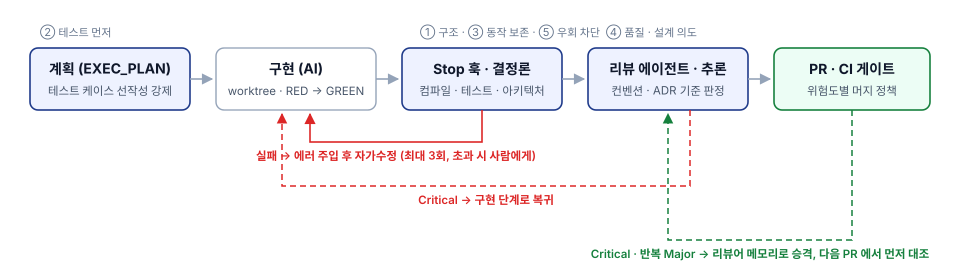
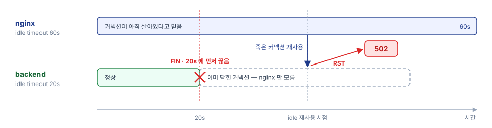

# KickLog

> 애플워치로 기록한 조기축구 경기를 쿼터 단위로 분석해 주는 iOS 앱과 Spring 백엔드

조기축구는 25분 × 4쿼터로 진행되고, 선수는 모든 쿼터를 뛰지 않습니다. KickLog 는 출전한 쿼터마다
워치에 기록된 Soccer 워크아웃을 **한 경기로 자동으로 묶고**, 이동거리·최고 속도·스프린트·심박을
쿼터별로 보여줍니다. 친구를 맺으면 서로의 경기 기록을 볼 수 있습니다.

- 1인 풀스택 개발 (iOS + 백엔드 + 인프라)
- 운영 중: `kicklog.org` (AWS 서울 리전)

---

## 주요 기능

| 기능 | 설명 |
|---|---|
| **경기 자동 그룹핑** | HealthKit 워크아웃을 시간 간격 90분, 거리 100m(Haversine) 기준으로 한 경기로 묶음 |
| **라벨링** | 출전 쿼터 체크, 상대팀·결과·포지션·골·어시스트·운동장 입력, 워크아웃 시작·종료 trim |
| **경기 리포트** | 이동거리 · 평균/최고 심박 · 최고 속도 · 스프린트 횟수 · 쿼터별 체력 변화 |
| **시즌 통계** | 연간·월별 누적 기록, 승률, 시즌 베스트 |
| **친구** | 1:1 양방향 친구, 친구의 경기·시즌 기록 열람 (심박 비공개 옵션) |
| **운동장** | 카카오 장소 검색 기반 운동장 등록·선택 |
| **로그인** | Sign in with Apple / 카카오 → 자체 JWT |

## 아키텍처

<p align="center">
  
</p>

- **iOS 가 매 경기 데이터의 1차 원본**입니다. HealthKit 원시 데이터는 기기에 두고, 분석 결과만 서버로 보냅니다.
- **백엔드**는 백업, 친구 공유, 시즌·월별 집계를 맡습니다
- **3-tier 구조 + DDD-lite**: Controller / Service / Repository, Rich Aggregate + `@Embeddable` VO,
  `Request → Command → Result → Response` DTO 흐름 — [domain-modeling.md](docs/architecture/domain-modeling.md)

## 기술 스택

| 영역 | 스택 |
|---|---|
| iOS | Swift · SwiftUI · SwiftData · Swift Charts · HealthKit · CoreLocation (iOS 18+) |
| Backend | Kotlin 2.2 · Spring Boot 4.0 · Java 17 · Spring Security (JWT) · JPA · Flyway |
| DB | PostgreSQL 16 |
| Test | Cucumber (인수 테스트) · JUnit 5 · Testcontainers |
| Infra | AWS EC2 (Graviton) · Terraform · Docker Compose · nginx · Cloudflare |
| CI/CD | GitHub Actions → GHCR → SSM Run Command (OIDC, SSH 미사용) |
| 관측 | Sentry · CloudWatch Alarm → SNS |
| 부하 테스트 | k6 · Prometheus · Grafana |

---

## 기술적 도전

### 1. AI 코드의 신뢰를 '주의'가 아니라 하네스로 강제해 리뷰 병목 해소

> GearShow · KickLog 공통 개발 방식 — 믿을 수 있는 코드의 조건을 먼저 정의하고, 판정 가능한 조건은 훅과 테스트로,
> 불가능한 조건은 학습하는 리뷰어로 수렴시킨 AI-Native 파이프라인

**Problem**

AI 를 쓰자 혼자서도 두 프로젝트에서 PR 을 매주 수십 개 머지할 만큼 빨라졌지만, 그 코드를 믿을 수는 없었습니다.
컨벤션과 아키텍처 경계를 넘나들었고, 막히면 테스트를 지우거나 `@Disabled` 로 '통과'를 만들었으며,
세션이 바뀌면 지난 결정을 잊고 다시 짰습니다. 결국 매번 전체 diff 를 제가 읽어야 했고,
**AI 의 속도는 제 리뷰 속도로 되돌아왔습니다.** 리뷰어도 QA 도 없는 1인 개발에서 이 병목을 '주의'로는 막을 수 없었습니다.

**Action**

하네스를 만들기 전에, 믿을 수 있는 코드의 조건을 다섯으로 나누고 각각 **판정이 가능한지**부터 가렸습니다.
판정 가능한 조건은 통과할 때까지 반복을 강제하고, 판정 불가한 조건은 리뷰로 수렴시켰습니다.

| 조건 | 판정 | 강제 수단 |
|---|---|---|
| ① 구조적 일관성 | 결정론 · Y/N | ArchUnit 4규칙(domain → Spring·JPA·adapter 의존 금지)과 JaCoCo 70% 를 `gradle check` 에 묶어 빌드가 위반을 차단 (GearShow) |
| ② 요구사항 충족 | 테스트 통과 | 계획 문서에 테스트 케이스를 먼저 채워야 편집이 열림. 인수(Gherkin·HTTP) · 통합(Testcontainers) · 단위 세 층 |
| ③ 동작 보존 | 특성화 · 동치성 테스트 | 리팩토링은 기존 동작을 테스트로 고정한 뒤 교체. 집계 이전 시 **기존 테스트 12개 무수정 통과** |
| ④ 품질 · 설계 의도 | 주관 · 수치화 불가 | 컨벤션·ADR 을 로드한 리뷰 에이전트. Critical 이면 구현으로 복귀, 반복 지적은 메모리로 승격 |
| ⑤ 검증 우회 | 금지 목록 | `@Disabled` · `skipTests` · `--no-verify` 를 **훅과 리뷰 체크리스트 양쪽에서 차단** |

<p align="center"></p>

- **판정 가능한 조건은 훅으로 강제하기** — AI 는 프롬프트의 지시는 무시할 수 있지만 **훅의 차단은 무시할 수 없습니다.**
  계획 없는 30줄 이상 편집, main 브랜치 직접 수정, 위험 명령은 PreToolUse 훅이 도구 호출 자체를 막습니다.
  작업 종료 선언 시 Stop 훅이 컴파일·테스트·아키텍처 검증을 돌려 실패하면 **에러를 주입하고 재개**시킵니다.
  3회를 넘기면 멈추고 사람에게 넘깁니다. 변경 유형별 위험도 표를 두어 **스키마·상태기계·이벤트 계약·보안 경계 변경은
  자동 머지를 금지**하고 ADR 이나 롤백 스크립트를 요구했습니다.
- **판정 불가한 품질은 학습하는 리뷰어로 수렴시키기** — 리뷰 에이전트에 프로젝트 컨벤션과 ADR 을 사전 로드해,
  AI 의 일반론이 아니라 **이 프로젝트의 기준**으로 판정하게 했습니다. Critical 과 반복 Major 는 리뷰어 메모리와
  학습 저널로 승격해 다음 PR 에서 먼저 대조합니다. 집계 SQL 전환에서 fan-out 과 스냅샷 불일치를 리뷰에서 잡은 뒤
  6항목 체크리스트로 남긴 것이 그 예입니다. 세션마다 리셋되는 기억은 ADR · 작업 계획 · 승격 규칙으로 문서에 두었고,
  Claude Code 와 Codex 가 같은 훅 스크립트를 공유해 모델이 바뀌어도 규칙은 유지됩니다.

**Result**

하네스 도입 후 6개월간 두 프로젝트에서 **PR 165개를 전부 자동 게이트 통과 후 머지**했고, 테스트 951개와
Gherkin 시나리오 73개를 유지했습니다. KickLog 는 **테스트 우회·비활성화 0건**, PR 생성에서 머지까지 중앙값
10분 이내로 사람 리뷰 대기가 사라졌습니다. 코드 읽기에서 벗어난 시간은 설계 결정으로 갔습니다.

**Reflection**

AI 코드의 신뢰는 모델이 아니라 검증 구조에서 나왔습니다. 제 역할은 코드를 한 줄씩 읽는 사람에서,
**무엇을 인수 조건으로 삼을지, 어떤 설계를 택할지, 병목이 어디인지**를 정하는 사람으로 옮겨갔습니다.

---

### 2. nginx 의 keep-alive 를 켜면 따라오는 502 race 를 해결

> 운영 중인 서비스에서 간헐적으로 터지던 502 — 재시도로 덮지 않고 TCP 레벨까지 원인을 추적해 커넥션 수명 설정으로 제거

**Problem**

App Store 에 출시해 실제 유저가 쓰고 있는 KickLog 운영 중, nginx 로그에서 **502 가 간헐적으로** 새고 있는 걸
발견했습니다. 앱 로그엔 흔적도 없고, 트래픽이 몰릴 때가 아니라 **한가할 때만** 터지는, 가장 잡기 까다로운 버그였습니다.

**Action**

1. 매번이 아니라 **간헐적으로, 그것도 재현 조건 없이** 터진다는 점에서 결정론적 버그가 아닌 **타이밍 race** 로 방향을 잡았습니다.
2. 앱 로그는 깨끗한데 nginx 만 `upstream prematurely closed` 를 찍는 걸 보고 **커넥션 레벨**로 좁혔습니다.
3. 직전에 켠 **nginx keepalive** 가 의심됐습니다 — 원래 요청마다 커넥션을 만들고 버려 **TIME_WAIT 소켓이 1.6만 개**씩
   쌓였고, 이 낭비를 없애려 켠 커넥션 재사용이 도리어 502 를 부른 것이었습니다.
4. 유저가 쓰고 있는 운영 서버에 부하를 걸 수는 없어, Docker · k6 · Grafana 로 **복제 환경을 만들어 재현** —
   **높은 부하엔 멀쩡하고 간헐 부하에서만 터지는** 역설에서 "idle 커넥션을 재사용하는 순간 깨진다"를 확인했고,
   범인은 **idle timeout 비대칭(nginx 60s · Tomcat 20s)** — backend 가 먼저 끊은 죽은 커넥션을 nginx 가 재사용해
   RST 를 맞는 구조였습니다.
5. **재시도로 덮는 대신** backend timeout 을 proxy 보다 길게 둬, 재사용될 죽은 커넥션 자체를 없앴습니다.

<p align="center"></p>

**Result**

간헐적으로 새던 **502 는 0** 이 됐습니다. keepalive 최적화는 그대로 지켜 **TIME_WAIT 1.6만 → 40개(99% 감소)**,
커넥션 1개당 3만 요청 처리도 유지했습니다.

**Reflection**

내 서비스를 실제 유저에게 운영해보니, 어쩌다 한 건 터지는 오류도 신뢰를 깨뜨린다는 걸 몸으로 배웠습니다.
재시도로 증상을 덮는 대신 TCP 바닥까지 파고들어 **재발 경로 자체를 제거**했습니다. 설정 한 줄은 AI 도 알려주지만,
어쩌다 한 번 깨지는 이유를 짚는 건 **검색으로 대체되지 않는 TCP 기본기**였습니다.

---

### 3. 78만 건 재업로드 배치 처리 시간을 21분에서 2분으로 단축

> 한 단계에 한 가지만 바꾸는 측정 사다리로 진짜 병목이 트랜잭션 수가 아니라 DB 왕복 횟수였음을 확인한 최적화

**Problem**

지표 알고리즘이 바뀌면 모든 사용자의 기기가 과거 경기를 다시 계산해 서버로 올립니다. 사용자 5,000명,
**경기 78만 건, 쿼터 312만 건**을 받는 데 **경기 1건당 PUT 1회** 구조로는 **21분 40초**가 걸렸습니다.
이 시간 동안 서버는 다른 요청을 제대로 받지 못합니다.

**Action**

1. 경기마다 보내던 PUT 을 **사용자당 1회 벌크 요청**으로 묶어 요청을 78만 회에서 5천 회로 줄였습니다.
2. 경기마다 다시 나가던 조회를 **fetch join 1회**로 바꿔 N+1 을 없앴습니다.
3. 390만 건의 UPDATE 를 **JDBC 배치**(`batch_size=50`, `order_updates`)로 묶어 DB 왕복을 줄였습니다.

**Result**

**21분 40초 → 2분 11초(9.9배).** 처리량은 초당 600경기에서 5,954경기로 늘었고, UPDATE 390만 행이
**전부 반영된 상태**의 수치입니다. 트랜잭션을 159배 줄인 1번 조치에서는 시간이 36%만 줄었습니다.
실제 시간은 DB 왕복을 걷어낸 2·3번에서 줄었습니다. (운영과 같은 구성의 AWS 복제 환경에서, 모든 단계를 같은 동시성으로 측정)

**Reflection**

"묶으면 빨라진다"는 직관은 절반만 맞았습니다. 병목은 트랜잭션 수가 아니라 **DB 왕복 횟수**였고,
조치를 하나씩 따로 측정했기 때문에 이 차이를 볼 수 있었습니다.

---

### 4. '1년치를 메모리에 올리던' 통계 집계를 DB 로 이전

> EXPLAIN 으로는 DB 시간이 그대로라 근거가 없던 리팩토링 — 측정 대상을 힙 할당으로 바꿔 23배 차이를 증명한 설계

**Problem**

시즌 통계는 **1년치 경기를 통째로 JVM 에 올려** 애플리케이션에서 합산하고 있었습니다.
장애 대응으로 **heap 이 3분의 1**이 되자, 이 방식이 **다음 장애 후보**가 됐습니다.

**Action**

1. 집계를 DB 로 내리기 전 EXPLAIN 으로 실측했더니 **DB 시간은 12.7ms → 12.1ms 로 그대로**였습니다.
   직관이 틀린 건지, 측정이 틀린 건지 가려야 했습니다.
2. 진짜 비용은 DB 밖에 있다고 보고 **호출당 힙 할당을 직접 재는 하네스**를 만들어 두 구현을 같은 조건에서 비교했습니다.
3. 쿼리를 쪼개자 **숫자만 조용히 틀리는 함정 두 개**(fan-out, 스냅샷 불일치)가 생겼고, 둘 다 테스트가 아닌 리뷰에서 잡았습니다.

**Result**

DB 실행 시간은 12.7ms → 12.1ms 로 그대로인데, **호출당 힙 할당은 2,726KB → 117KB 로 23배**, GC 는 47회 → 1회,
반환 행은 1,200행 → 14행으로 줄었습니다. 애플리케이션 비용만 사라진 것입니다.
기존 테스트 12개를 **한 줄도 고치지 않고 통과**시켜 동작 보존을 증명했습니다.

**Reflection**

"DB 가 더 잘하니 DB 로"는 이 규모에선 절반만 맞았습니다. **무엇을 측정할지 정하는 것**이 측정 자체보다 어려웠습니다.

---

## 로컬 실행

```bash
# 1. DB
cd infra && docker compose up -d postgres

# 2. 백엔드
cd backend && ./gradlew bootRun     # 실행
cd backend && ./gradlew check       # 테스트 + 정적 검사 (Docker 필요 — Testcontainers)

# 3. iOS
open ios/KickLog.xcodeproj
```

## 문서

| 문서 | 내용 |
|---|---|
| [PRD](docs/PRD.md) | 제품 요구 사항 |
| [ADR](docs/adr/) | 설계 결정과 근거 (0001~0016) |
| [API 명세](docs/spec/api-spec.md) | REST 엔드포인트 계약 |
| [다이어그램](docs/spec/diagram.md) | ERD, 인증 시퀀스 |
| [테스트 전략](docs/spec/test-strategy.md) | ATDD(Cucumber) 기반 |
| [아키텍처](docs/architecture/) | 패키지·레이어 · 도메인 모델링 · 인증 · API 규약 |
| [부하 테스트](loadtest/README.md) | keepalive 실험 하네스 |

## 로드맵

- 스프린트·최고 속도 지표 재설계 (GPS 노이즈 필터링 v3)
- 풋살 모드 (실내, GPS 없음)
- 팀 단위 기능
- 자체 watchOS 앱

## License

Private project. All rights reserved.
