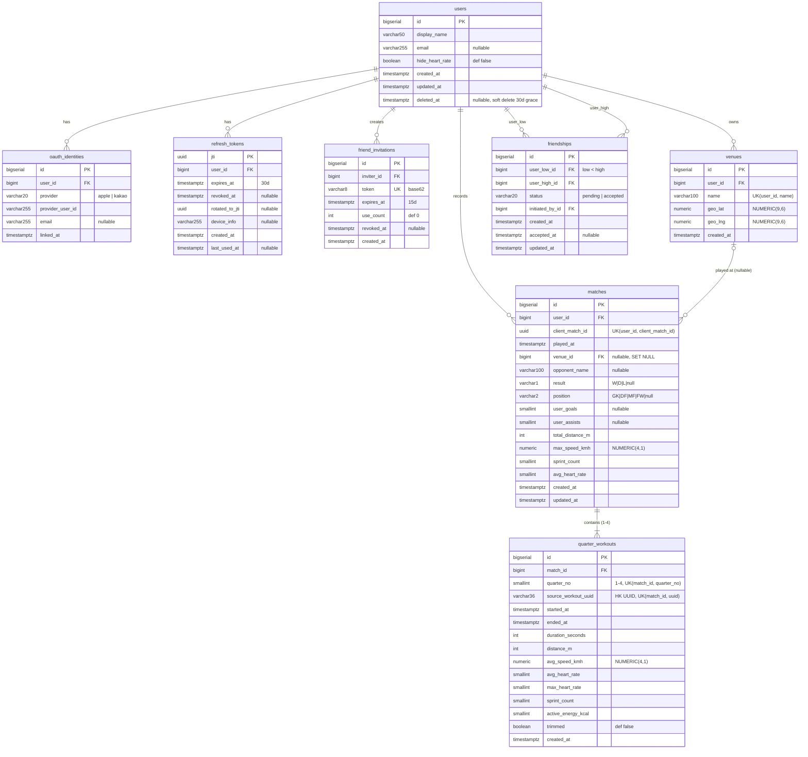
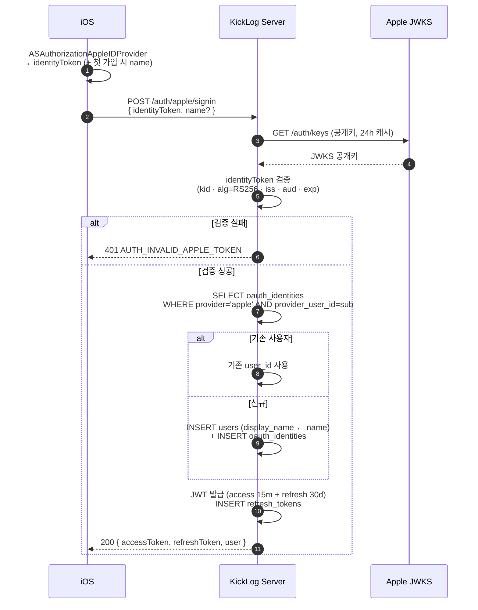
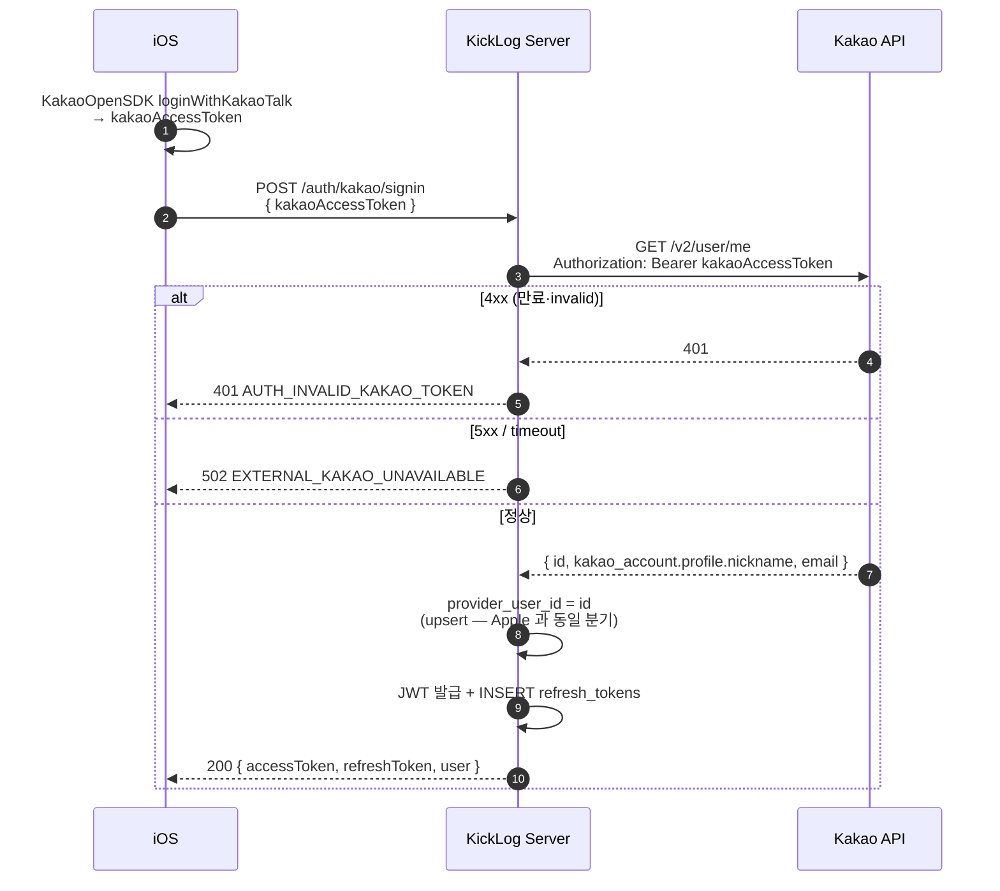
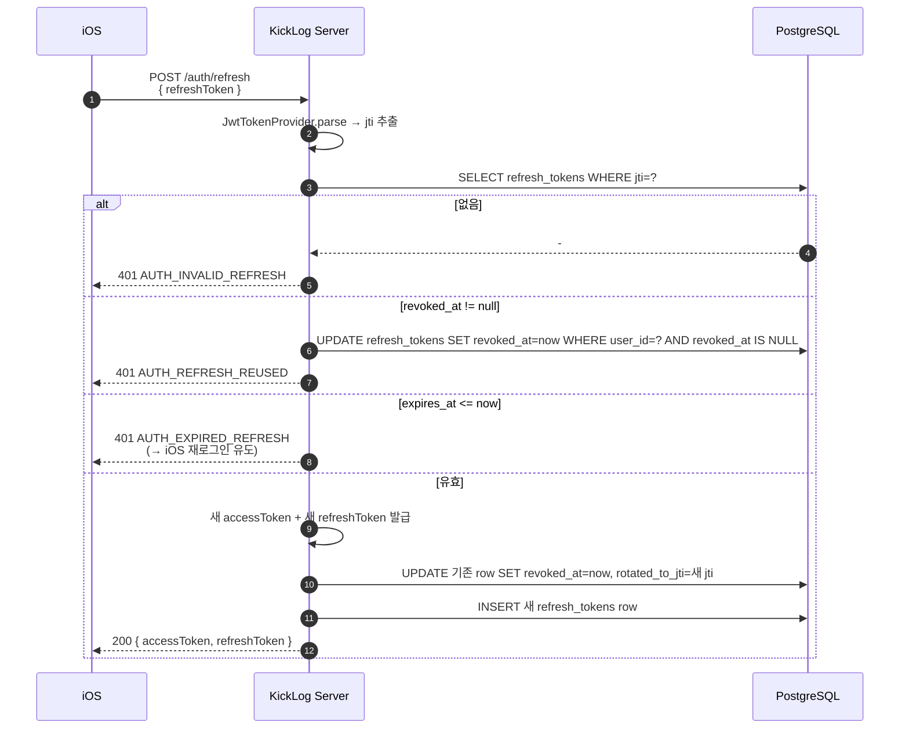
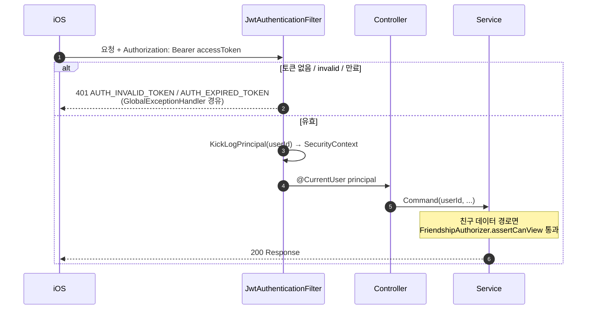

# KickLog 다이어그램

> Mermaid 로 작성 — GitHub·VS Code 에서 렌더링된다.
> 현재 수록: **ERD**(테이블 관계) + **인증 시퀀스**(Apple/Kakao/Refresh).
> 패키지·레이어 구조는 `architecture/overview.md`, 동기화 흐름은 ADR-0003 D9 의 ASCII 다이어그램 참조 (필요 시 본 문서로 이관).
>
> **정본 관계**: 스키마 정본은 ADR-0003 의 PostgreSQL Schema + Flyway 마이그레이션(`db/migration/V*.sql`). 인증 흐름 정본은 `architecture/auth.md`. 본 문서는 **시각화**이며, 충돌 시 정본 우선.

---

## 1. ERD — 데이터 모델

ADR-0003 의 8개 테이블. `users` 가 모든 도메인의 루트, 친구 관계는 `users` 자기참조(정렬 pair).

### 관계 요약

| 부모 | 자식 | 카디널리티 | ON DELETE | 비고 |
|---|---|---|---|---|
| users | oauth_identities | 1:N | CASCADE | MVP 는 사실상 1:1 (provider 별 별도 계정, ADR-0003 D7) |
| users | refresh_tokens | 1:N | CASCADE | 기기/세션당 1 row |
| users | friendships | 1:N (×2) | CASCADE | `user_low_id`·`user_high_id` 양쪽 FK + `initiated_by_id` |
| users | friend_invitations | 1:N | CASCADE | inviter |
| users | venues | 1:N | CASCADE | `(user_id, name)` UNIQUE |
| users | matches | 1:N | CASCADE | `(user_id, client_match_id)` UNIQUE (멱등 PUT) |
| venues | matches | 0..1:N | **SET NULL** | venue 삭제해도 경기 보존 |
| matches | quarter_workouts | 1:N (1~4) | CASCADE | `quarter_no` 1~4, HK UUID 둘 다 UNIQUE |

> **friendships 자기참조 주의**: `user_low_id < user_high_id` CHECK 로 같은 두 사용자 사이 항상 1 row 보장 (ADR-0003 D3). 조회 시 `LEAST/GREATEST` 로 pair 정렬 후 접근.

---

## 2. 인증 시퀀스

정본은 `architecture/auth.md`. OAuth provider token 은 첫 가입·로그인 시 1회만, 이후 모든 API 는 우리 JWT.

### 2.1 Apple Sign-In

### 2.2 Kakao Login

### 2.3 Token Refresh

access token(15m) 만료 시 iOS 가 호출. refresh token 은 매 갱신마다 rotation 된다.

### 2.4 보호 endpoint 인증 (매 요청)

---

## 변경 이력

| 날짜 | 변경 | 사유 |
|---|---|---|
| 2026-05-22 | 초기 작성 — ERD(8 테이블) + 인증 시퀀스 4종(Apple/Kakao/Refresh/보호 endpoint) Mermaid | 분산된 ASCII 다이어그램 통합 + ERD 신규. 구현 시 데이터 관계·인증 흐름 직참조용 |
